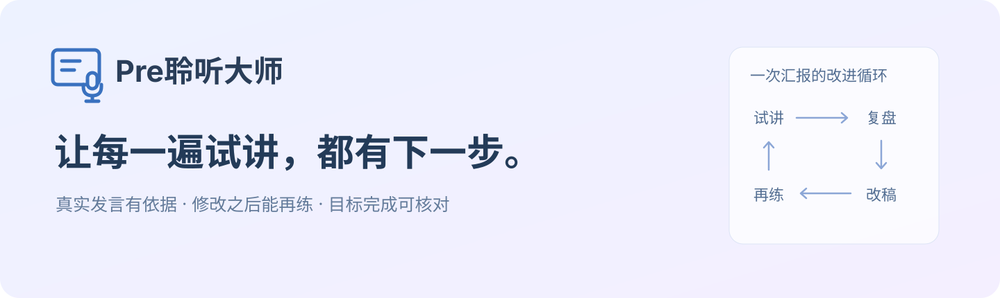
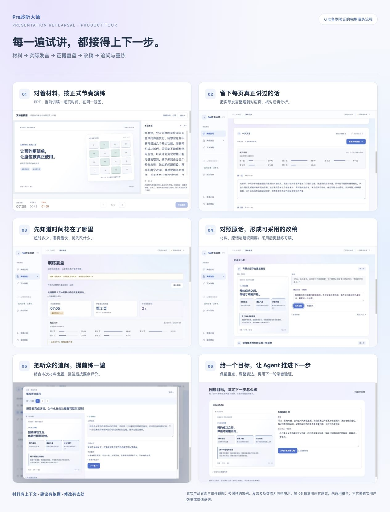

<div align="center">



**在正式汇报之前，先把需要改的地方练出来。**

PPT 上的内容 · 真正讲出的话 · 每一页的时间

[产品全景](docs/PRODUCT-TOUR.md) · [产品设计](docs/PRODUCT.md) · [反馈与迭代](docs/ITERATIONS.md) · [Agent 与 Harness](docs/ARCHITECTURE.md) · [运行与验证](docs/SETUP.md)

</div>

## 做好了 PPT，不等于准备好了汇报

你把 PPT 改到深夜，试讲时却发现：背景讲了太久，最重要的方案只能匆匆带过；有的页自己觉得解释清楚了，一被追问就卡住。录音能留下这一遍，但要自己回听、对照每页、整理成下一遍讲稿，仍然很费劲。

**Pre聆听大师把“再练一遍”变成一个有依据、有取舍、有验证的过程。** 导入材料，按正式节奏讲一次，找到值得改的一段；保留你的事实和表达习惯，整理成可继续练习的讲稿，再用下一轮演练检验调整。

<a href="docs/PRODUCT-TOUR.md"></a>

<sub>真实界面与组件截图；案例和反馈为虚构演示，不代表真实用户数据或模型效果。</sub>

**[逐步看完整体验：10 张界面图，从导入材料到下一轮验证 →](docs/PRODUCT-TOUR.md)**

## 一次演练之后，接下来做什么？


| 用户此刻的问题 | 产品给出的帮助 | 怎样走到下一步 |
| --- | --- | --- |
| 有材料，但还没有逐字稿 | 录音转写，结合网页翻页记录整理发言 | 从实际说法整理练习稿，保留自然表达 |
| 总是超时，不知道该删哪里 | 逐页计时，关联原话提出压缩候选 | 选择保留内容、采用改稿，再练验证 |
| 建议看着有道理，却不敢直接用 | 原话、对应 PPT、修改理由放在一起 | 核对事实，编辑后采用；原始发言仍保留 |
| 内容熟了，一追问还是卡住 | 结合材料与发言准备 3–10 道听众问题 | 按同一题的评价要点点评、改写、重答 |

### 材料、发言和练习稿各司其职

- **材料**提供背景：支持 PPT/PPTX/PDF；读取 PPT 每页备注；导入 DOCX、文本 PDF、TXT 讲稿并辅助分段关联。
- **实际发言**提供证据：记录翻页与用时；转写可核对、可编辑；录音中断后可继续汇报。缺失翻页记录的内容保持“待确认”，不擅自归到第一页。
- **练习稿**承接修改：建议经用户采用后更新；原稿、原始发言分别保留。演讲者视图展示材料与讲稿，服务下一次真实演练。


[看逐页发言](docs/PRODUCT-TOUR.md#03-把每一页真正讲过的话留下来) · [看采用后的讲稿](docs/PRODUCT-TOUR.md#06-采用以后修改有去处) · [看演讲者视图](docs/PRODUCT-TOUR.md#02-对着材料按正式节奏讲一遍)

### 问答练习延续这一场汇报

听众问题围绕当前材料和真实发言展开，PPT 与题目同时可见。每题保存专属评价要点，重答时沿用同一标准；缺少事实时先澄清，参考回答不会自动覆盖原回答。首题可以先由本地材料生成起始问题，其余问题异步补齐，缩短空白等待。


## AI 不只生成一份报告，还参与下一步决策

产品保留直接、可预测的操作流程，同时提供一个**有明确任务边界的目标驱动 Agent**。例如目标是“保留研究方法，把汇报讲进 5 分钟”：

1. 读取实际计时和发言证据，判断条件是否足够。
2. 在诊断、压缩、澄清、重新演练、目标确认之间选择下一步。
3. 用户选择“这段需要保留”后，记录取舍约束，换一处建议或重新判断。
4. 采用改稿后进入下一轮试讲，以新录音验证实际用时；是否保留重点由用户确认。


<sub>实际组件的合成交互演示，展示复用已有建议的路径，本图未调用模型。[查看采用之后怎样进入下一轮 →](docs/PRODUCT-TOUR.md#09-围绕一个目标决定下一步怎么练)</sub>

已有可用建议直接复用，无需让模型重复规划。工具通过本地 MCP 提供指定页上下文和计时摘要；模型不能执行任意命令，也不能自动改写外部文件。

**这里的 Agent 是演练流程中的决策模块。** 录音、计时、保存等交给确定性代码；需要语义判断的部分才交给模型。[查看决策循环、工具边界与实现位置 →](docs/ARCHITECTURE.md)

## 让建议值得相信：Harness 落在这些地方

| 容易出现的 AI 问题 | 实际约束 |
| --- | --- |
| 把自然转述当成“没有照着 PPT 讲” | 区分材料与发言，允许同义改写、口头补充；诊断经过独立语义复核 |
| 把转写错字当成发音或表达问题 | 提供人名术语辅助识别、核对入口；文本模型不推断自己没听过的发音 |
| 引用不存在的原话 | 用页码、段落 ID 与原文核验引用，不通过的候选不直接展示 |
| 为了让改稿更漂亮补造数字与成果 | 数字和事实保护；缺少必要事实先澄清，保留“计划 / 假设”的状态 |
| 模型一直尝试，用户一直等待 | 白名单动作、调用预算、有限重试、取消与超时；复用已成功的结果 |
| 改了稿就宣布“进步了” | 只有独立的新录音才能做前后比较；不足以验证时不宣布达标 |

## 产品是怎样被试用反馈改变的

最有价值的反馈常常不是“再加一个功能”，而是“我不知道这一步为什么要做”“我还在等上传”“我只是换了一种说法”。这些问题改变了功能优先级，也改变了实现方式。

- **从等全部转换，到先看首屏：** PPTX 本地首屏预览与后台转换拆开；后续页面逐步加载。复杂图形和旧版 PPT 仍受转换耗时影响。
- **从中断即重来，到接着讲：** 增加录音前检测、分段保存、继续演练和恢复；转写失败也能直接编辑发言。
- **从堆建议，到明确下一步：** 精简重复说明，让原话、建议稿和 PPT 靠近；采用建议后更新讲稿，再进入练习。
- **从多挑问题，到证据优先：** 不要求输出固定数量的不足；短发言或证据不足时提示边界和下一步，而非用无根据的建议凑数。

[阅读关键反馈、设计取舍和仍需验证的问题 →](docs/ITERATIONS.md)

## 运行这个项目

需要 **Node.js 22+**。不配置模型密钥也可以启动，点击侧栏「查看示例」体验预设流程。

```bash
git clone https://github.com/ZhengZizhen-Zzz/pre-listening.git
cd pre-listening
npm ci
cp .env.example .env
npm start
```

打开 `http://127.0.0.1:3210`。真实诊断配置 DeepSeek，语音识别配置百炼；完整 PPT 转换另需 LibreOffice。详见[安装、模型配置及平台限制](docs/SETUP.md)。

GitHub 展示源码、截图和文档；完整 AI 功能需要运行后端。此仓库不附带私人试用密码、临时服务地址或共享模型密钥。

## 验证与当前边界

- **302 项自动化测试通过**（2026-10-14 公开版检查），覆盖证据校验、改稿事实保持、计时、任务隔离、录音恢复、导入、缓存、限额与目标决策。执行 `npm test`。
- 公开提供 **29 条合成评估输入**，可离线校验；真实模型评估需主动选择案例并设置调用上限。
- 已做真实模型与浏览器链路验证；公开记录区分合成样本、预设演示和真实用户反馈。测试通过不等于用户效果已经得到证明。
- 当前仍是持续验证中的产品：复杂 PPT 兼容性、不同手机系统的录音恢复、大文件弱网表现，以及建议采纳后的实际改善，仍需持续验证。

[测试范围、复现方式与已知边界 →](docs/VALIDATION.md)

## 实现导航

| 想了解什么 | 从这里开始 |
| --- | --- |
| 需求优先级与用户准备状态 | [产品设计](docs/PRODUCT.md) |
| 每轮反馈如何变成决策 | [迭代记录](docs/ITERATIONS.md) |
| 目标 Agent 与 MCP 工具 | [架构说明](docs/ARCHITECTURE.md)、[目标决策模块](lib/goal-agent.mjs) |
| Prompt 与证据复核 | [诊断](lib/providers.mjs)、[语义复核](lib/evidence-review.mjs)、[改稿](lib/rewriter.mjs) |
| 可靠性与效果评估 | [验证说明](docs/VALIDATION.md)、[测试代码](test) |
| 数据处理和公开范围 | [数据说明](docs/DATA.md)、[第三方声明](THIRD_PARTY_NOTICES.md) |

产品定义、场景取舍、交互验收与迭代方向由作者推进，开发过程中使用 AI 编程工具协作实现。公开版本保留可运行代码和验证方法，方便复现设计背后的判断。
