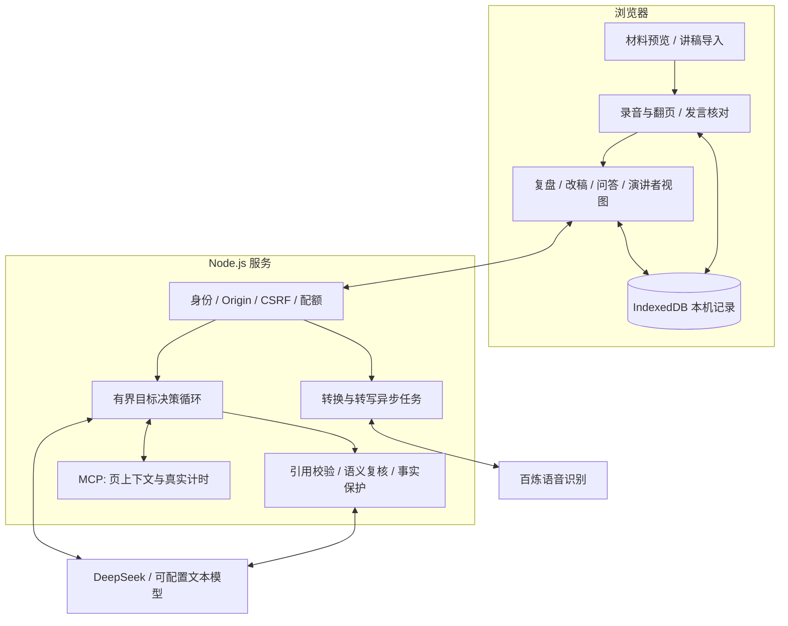
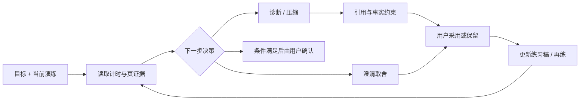

# 一套可控的演练系统，和其中的目标 Agent

## 系统结构

前端采用原生 ES Modules，后端为 Node.js HTTP 服务。esbuild 在启动时生成压缩资源；PDF.js 在浏览器预览，LibreOffice 负责完整 PPT 转换。浏览器保存演练内容，服务端按任务暂存处理所需数据；具体数据路径见 [DATA.md](DATA.md)。

## Agent 到底决定什么

目标模块位于 `lib/goal-agent.mjs`，前端协调位于 `public/goal-agent.mjs` 与 `public/goal-core.mjs`。它维护目标时长、基线演练、当前轮次、用户要保留的内容、采用记录和任务结果。模型只能选择：

| 动作 | 触发条件与输出 |
| --- | --- |
| diagnose | 根据材料、发言和目标定位表达问题 |
| compress | 有可信计时且确实超时，提出有原话依据的取舍方案 |
| clarify | 证据不足，或不能在现有约束下继续，需要用户补充 |
| rehearse | 已有可用调整，转入真实再练 |
| complete | 满足计时等条件后转为用户确认，不自动宣布全部目标已验证 |

如果已有通过校验的方案，直接展示；若用户要求保留某段，则过滤受保护内容并在需要时重新决策。模型看到工具观察后决定后续动作，而不是只输出一条固定链。普通上传、录音、计时、存储仍是确定性工作流。

## 工具与权限边界

`lib/coach-mcp-client.mjs` 通过 stdio 调用 `scripts/coach-mcp.mjs` 的本地工具：

- `get_page_context`：本次会话指定页的材料、实际发言及段落编号。
- `get_timing_summary`：真实翻页事件、累计用时、目标差值和证据完整性。

工具进程没有模型密钥，不接受任意路径、URL、代码或跨用户记录 ID。它不是公网 MCP 服务，也没有连接 WPS 账户或编辑第三方文档。MCP 负责工具接口，实际价值来自被读取的证据和后续决策。

## Harness 是模型周围的执行与质量约束

| 层 | 机制 | 主要位置 |
| --- | --- | --- |
| 输入 | 结构校验、来源分离、将材料里的指令作为数据 | `public/core.mjs`、`lib/providers.mjs` |
| 证据 | 原话引用校验、跨页上下文检查、独立语义复核 | `lib/evidence-review.mjs` |
| 改稿 | 数字保护、事实澄清、原稿保留、用户采用 | `lib/rewriter.mjs`、`public/revision-core.mjs` |
| 执行 | 动作白名单、有限轮次与调用、取消和超时 | `lib/goal-agent.mjs`、`lib/coach-runs.mjs` |
| 恢复 | 任务去重、读取重试不重复付费提交、成功步骤复用 | `lib/question-jobs.mjs`、`lib/transcription-jobs.mjs`、`public/retry-read.mjs` |
| 访问 | Origin / CSRF、会话隔离、试用上限、管理端隔离 | `server.mjs`、`lib/trial-access.mjs` |
| 评价 | 合成边界案例、原文真实性和事实保持检查 | `test/`、`evals/quality/cases.json` |

当前目标循环最多 3 次模型决策，每次执行尝试最多 10 次模型请求，整体超时 180 秒，允许一次主动重试。旧的自然语言复合任务模块有自己的 4 分钟执行上限；不能把不同入口的限制混为一谈。预算是防失控边界，不是延迟目标。

目标确认需要可信计时与完整录音；比较改善还需要同一汇报条件下独立的新轮次与新录音。改字、续录、人工缩短文本均不能伪造新一轮效果。

## Prompt 的迭代不是“说得更严厉”

1. 明确幻灯片、发言、目标三种输入，允许自然转述。
2. 标记 ASR 来源和材料提取覆盖范围；没有文字不代表材料没内容。
3. 将候选生成与独立语义复核分开，避免仅靠模型自称有依据。
4. 将计划、假设、结果分开，不让改写把不确定事实升级为成果。
5. 问题附带专属评价要点；重练沿用同一题的标准。
6. 保护用户明确要保留的内容；时长是上限，不要求为凑满时间加话。

Prompt 与版本标记在 `lib/providers.mjs`、`lib/evidence-review.mjs`、`lib/rewriter.mjs`、`lib/training.mjs`、`lib/goal-agent.mjs` 中，能够和具体回归用例一起阅读。

## 当前工程边界

- 任务状态部分在服务端内存，约 2 小时到期；服务重启后未完成的 Agent 任务需要重新安排，浏览器已保存的结果仍保留。
- 当前是单进程服务和本机浏览器存储，没有跨设备账户同步与生产级任务队列。
- 录音与页面计时不是对声学情绪、肢体动作或现场表现的全量评价。
- 源码通过 AI 编程协作实现；工具接入与测试数量本身不能证明产品价值。
