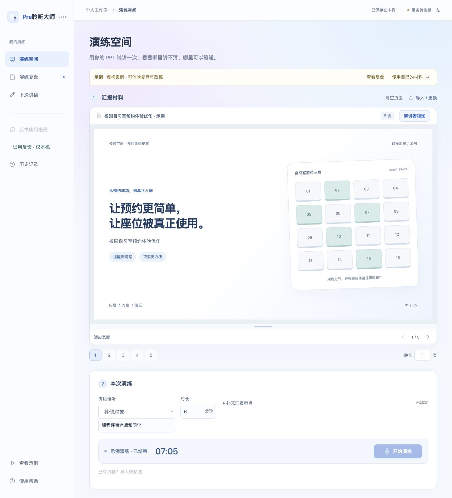
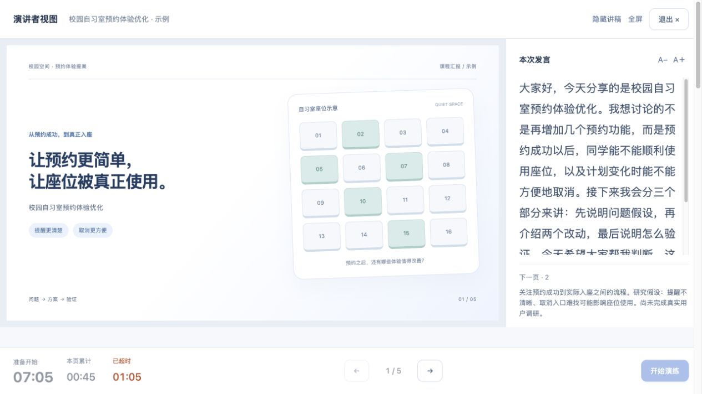
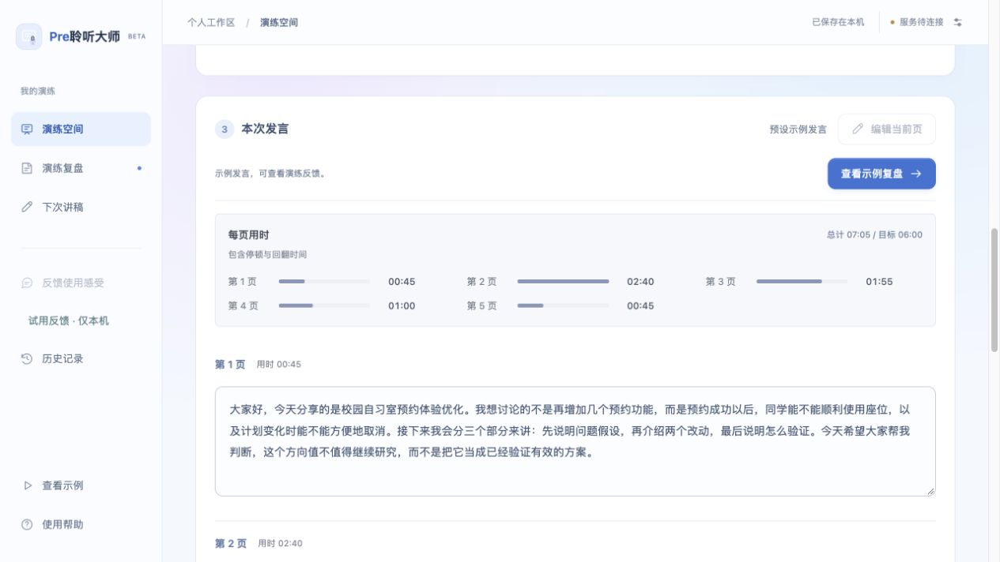
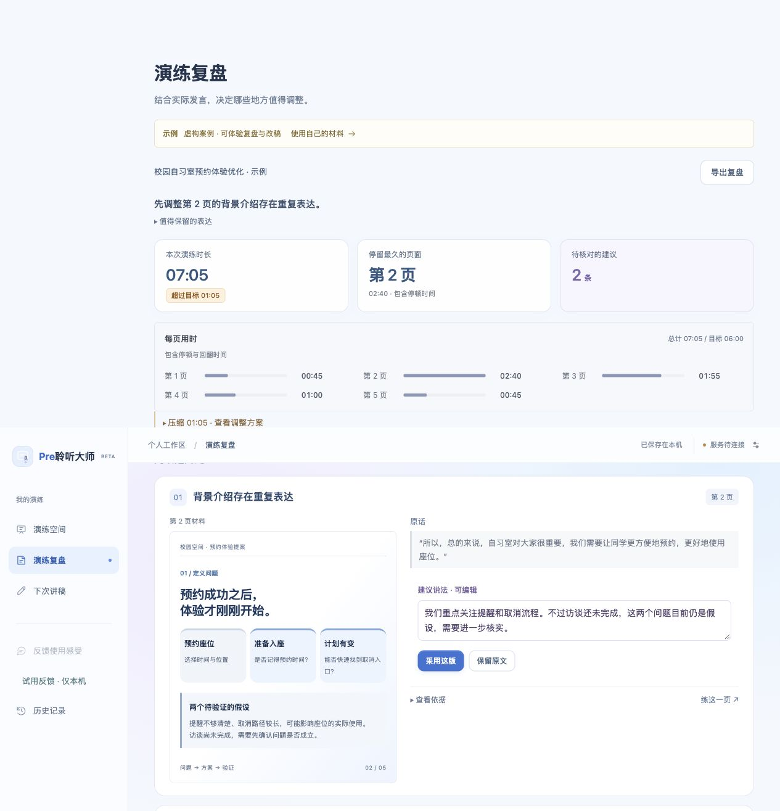
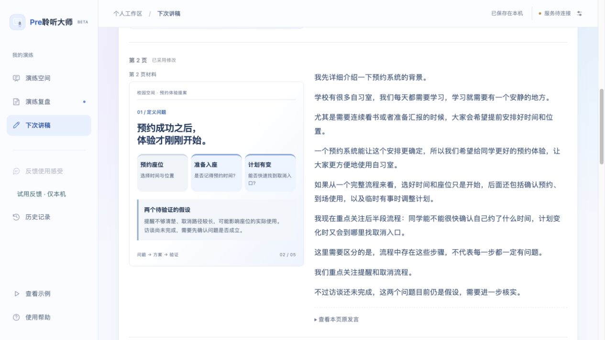
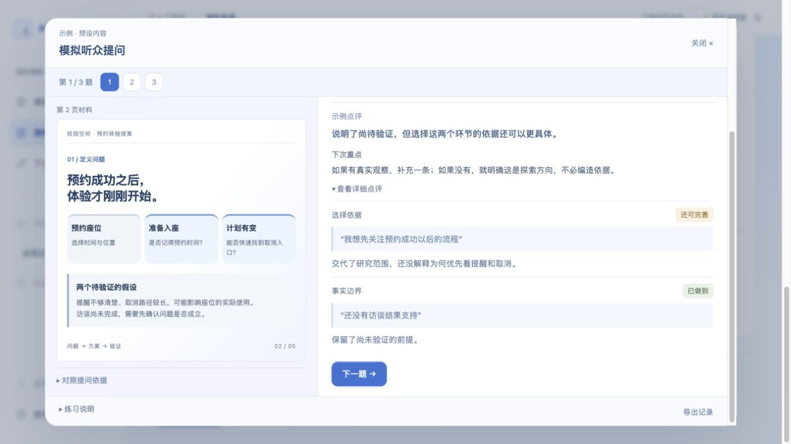

# 从一次试讲，到下一轮更有准备

**先看体验，再看实现。** 这组图片沿着同一场“校园自习室预约体验优化”汇报展开，让材料、发言、建议和下一版讲稿之间的关系连起来。

[返回项目首页](../README.md) · [产品设计](PRODUCT.md) · [Agent 与 Harness](ARCHITECTURE.md)

> 以下是可运行产品的真实界面截图。校园预约案例、发言、时间记录与点评均为虚构预设；Agent 部分是实际组件加载合成输入的交互演示，复用已有建议，未调用模型。图片用于解释交互和数据流，不作为真实用户效果证明。演示环境未配置模型，因此部分按钮停用；可配置服务后体验真实演练。

## 01 材料和讲稿各自进入合适的位置

用户可以带着 PPT/PDF 来，也可以带着已有讲稿来。设置听众和目标时长后进入演练；已有 DOCX、文本 PDF、TXT 讲稿可以导入分段关联，PPT 备注保留原文。材料负责提供上下文，讲稿用于准备和提示，不自动当成“已经说过的话”。

## 02 对着材料，按正式节奏讲一遍

演讲者视图把 PPT、当前稿件、下一页提示和计时放在一起。翻页时记录页面停留时间；用户不必在 PPT 和聊天窗口之间反复切换。右侧可显示当前练习稿、导入讲稿或 PPT 备注等可用内容。

## 03 把每一页真正讲过的话留下来

实际录音转写与网页翻页时间线关联；用户可以核对识别文字并调整页码。核对后的发言成为后续复盘和改稿的依据。图中是示例发言，真实演练支持编辑；没有可靠翻页记录时保留为待确认，不强行分配。

## 04 先看整体，再决定从哪里改

本次总时长、超过目标的时间、停留最久的页面、逐页时间放在同一张总览里。用户先定位问题集中在哪，再进入具体建议；这些时间来自演练记录，不是模型根据字数猜测。

## 05 把建议放回原话和材料里判断

左边直接看对应 PPT，右边对照原话与建议表达。建议稿允许再编辑；“采用这版”和“保留原文”都是有效选择。以图中的修改为例，删掉重复背景，同时保留“访谈尚未完成、仍是假设”的事实边界。

## 06 采用以后，修改有去处

采用的段落更新到“下次讲稿”的对应页，未改动部分继续保留。用户能看到“已采用修改”的状态，也能回看本页原发言，随后用新稿继续演练。**采用建议是一处内容更新，不是覆盖原始录音或宣布已经进步。**

## 07 问题围绕这一场汇报展开

模拟提问把对应材料和问题放在一起。问题围绕材料与实际发言中的依据、取舍和未交代清楚的地方，用户可以逐题练习；真实流程支持准备 3–10 题，示例展示 3 题。

## 08 回答之后，知道具体缺在哪里

点评落到该题的评价要点和回答原句。图中分别检查“选择依据”和“事实边界”，区分已经做到与仍需完善的内容；补充事实、改写、同题重答后继续核对。每题保留专属要点，避免前后练习换一套标准。

## 09 围绕一个目标，决定下一步怎么练

例如“讲进 6 分钟，同时保留尚待验证的事实”。Agent 结合演练状态、用时与证据，提出具体候选；用户可以编辑采用，也可以要求保留这段，形成下一步约束。

**采用后，下一步变成重新演练。** 修改进入练习稿；只有下一轮新的录音，才能继续核对实际时长。是否保留重点仍由用户确认。

本组 Agent 图片由项目的 `createGoalAgent` 实际组件生成，使用合成演练数据与已有建议；演示夹具不调用模型、不保存用户数据。它展示的是缓存建议路径和采用后的状态迁移。实际模型怎样选择动作、哪些结果被拦截，见[Agent 决策实录](AGENT-TRACE.md)；实现与验证范围见[架构说明](ARCHITECTURE.md)和[验证说明](VALIDATION.md)。

## 每个界面背后的设计取舍

| 界面行为 | 对应的实际反馈 | 设计回应 |
| --- | --- | --- |
| PPT 与建议、问题同屏 | 看到页码后还得返回找内容 | 让核对发生在当前页面 |
| 每页一个发言框 | 转写碎片太多、难以修改 | 按页整理，必要时再展开细分片段 |
| 自然转述可以保留 | 换一种说法被误判为错误 | 语义与证据复核，不要求照念 PPT |
| 采用后更新对应页讲稿 | 不知道改完之后内容去哪了 | 给出更新状态，并保留原始发言 |
| 先出现首屏和起始问题 | 长等待让用户直接离开 | 本地首屏与异步补齐拆开，复杂文件仍需转换 |
| Agent 接受“这段需要保留” | 不能只追求缩短而丢失重点 | 记录取舍约束，重新选择或先澄清 |

[继续阅读用户反馈与迭代记录 →](ITERATIONS.md)

---

截图记录：2026-10-14。展示图由原始截图排版，未生成虚构产品控件或用户结果。流程总览的排版源文件在 [showcase/overview.html](showcase/overview.html)；Agent 组件演示源文件在 [showcase/agent-preview.html](showcase/agent-preview.html)。从仓库根目录启动静态文件服务可查看；真实产品仍按 [SETUP](SETUP.md) 运行后端。
